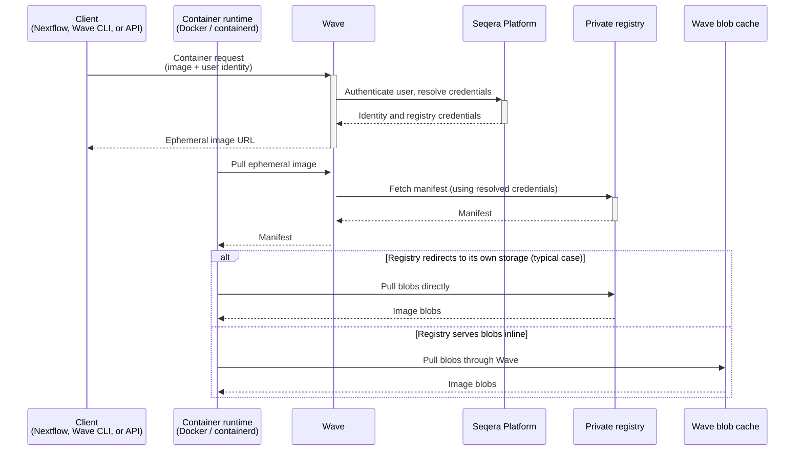

Wave provides transparent access to private container registries. Credentials live in Seqera Platform. You do not handle registry passwords, access tokens, or Docker config files directly.

Wave supports Docker Hub, Quay.io, AWS ECR (private and public), Azure Container Registry, Google Artifact Registry, GitHub Container Registry, and any OCI (Open Container Initiative)-compliant self-hosted registry. Credentials are added in [Seqera Platform credentials](https://docs.seqera.io/platform/latest/credentials/overview/). When a Wave client runs, Wave uses the stored credentials on your behalf to pull from the source registry. For freeze and mirror operations, Wave also pushes to the target registry.

:::note
See [Credentials overview](https://docs.seqera.io/platform/latest/credentials/overview/) for setup details.
:::

## Use cases

Use cases for private registry authentication include:

- **Centralized credential management**: Credentials live in Seqera Platform as a single source of truth. They integrate with Platform role-based access control.
- **No per-pipeline configuration**: Pipelines reference images by URI, and Wave resolves the credentials.
- **Reduced credential leakage risk**: Secrets are not stored in pipeline code or Docker config files.
- **Cross-registry pipelines**: Access and publish private images across multiple providers in a single run, including Docker Hub, Quay.io, ECR, ACR, GAR, GHCR, and self-hosted registries.

## How it works

The authentication flow runs as follows:

1. A Wave client (Nextflow, the Wave CLI, or the Wave API) submits a container request with the private image URI and your Seqera Platform access token.
2. Wave authenticates the caller against Seqera Platform and resolves the registry credentials stored in your workspace.
3. Wave returns an ephemeral container image name, for example `wave.seqera.io/wt/<access-token>/library/alpine:latest`. The 12-character access token is a short-lived random key scoped to this request. It authorizes the follow-up pull without requiring the container runtime to supply source-registry credentials.
4. The container runtime pulls the ephemeral image. Wave resolves credentials for the source registry and fetches the manifest. For most public registries, Wave returns an HTTP redirect and the runtime pulls blobs directly from the registry's storage. When a source registry serves blob bytes inline, Wave caches and streams the blobs through its blob cache.

### Credential resolution

Wave resolves registry credentials based on whether the request is authenticated:

- **Authenticated requests** use credentials stored in your Seqera Platform workspace. Wave queries the Platform credentials service with your access token and selects the container registry credential that most specifically matches the image repository.
- **Anonymous requests** and requests targeting Wave's own build, cache, or public repositories use credentials configured by the Wave operator.

For AWS ECR, Wave can additionally authenticate using its own cloud identity, removing the need to store ECR credentials in your workspace.

#### Registry matching

The **Registry server** value of a container registry credential can be a bare host, such as `quay.io`, or a host followed by a repository path, such as `quay.io/org`. Path-scoped credentials let you use different credentials for different repositories on the same host.

Wave compares the registry value against the full image repository, such as `quay.io/org/image`. The following rules apply:

- A registry value matches when it equals the repository or is a prefix of it that ends at a `/` boundary. `quay.io/org` matches `quay.io/org/image` but not `quay.io/organization/image`.
- When several credentials match, Wave uses the one with the longest registry value. A bare-host credential applies to any repository on that host that no more specific credential matches.
- If two credentials have the same registry value, Wave uses only one of them. Avoid duplicate registry values in a workspace.
- Wave normalizes Docker Hub official images, so `ubuntu` becomes `docker.io/library/ubuntu`. A bare `docker.io` credential still matches. A path-scoped credential for an official image must include the `library/` path, for example `docker.io/library/ubuntu`.

When Wave builds a container image, the build uses one credential per registry host. The build and cache repository credentials take priority over base image credentials. If a base image comes from another repository on the same host as the build repository, Wave pulls it with the build repository's credential.

The workspace used for credential lookup depends on the request context. If `tower.workspaceId` is set in the Nextflow configuration, Wave uses that workspace. Otherwise, Seqera Platform defaults to your personal workspace.
